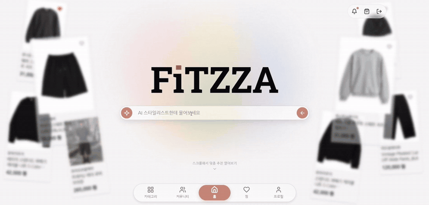
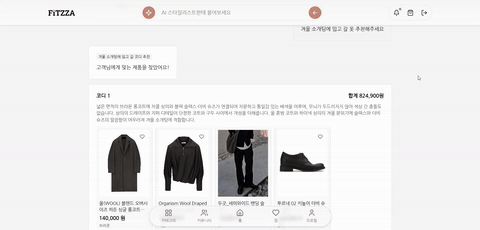
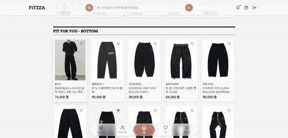
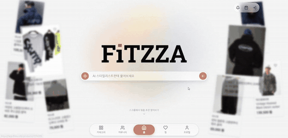
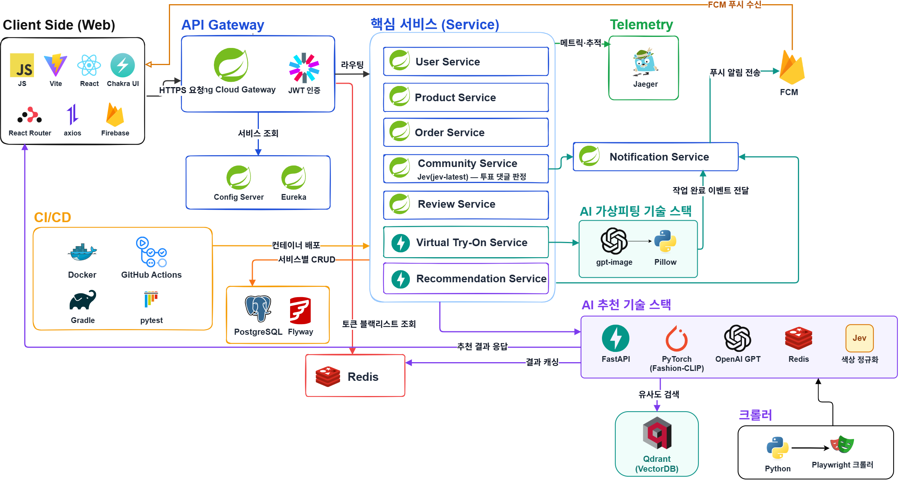
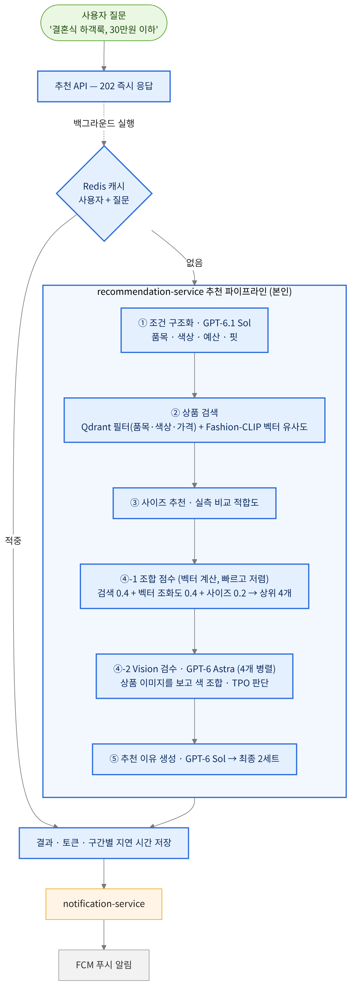
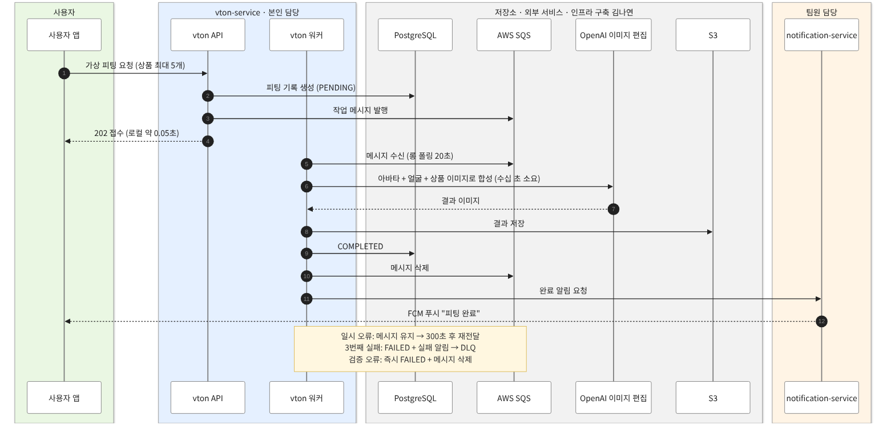
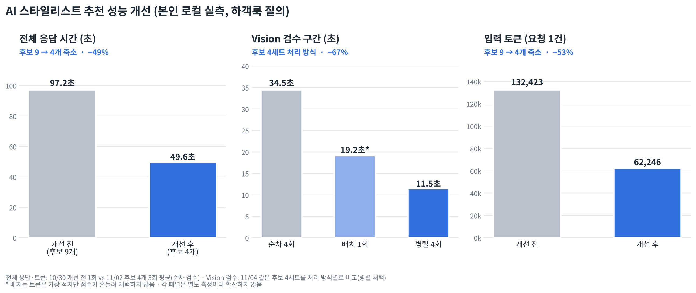

<div align="center">

# 👕 FITZZA (핏짜)

**"소개팅에 입고 갈 옷 추천해줘, 20만 원 이하로"처럼 말하면<br/>AI가 코디 세트와 맞는 사이즈를 추천하고, 가상 피팅으로 미리 입어보게 하는 패션 커머스**

[📂 원본 레포](https://github.com/duckfairy-wak/fitzza_msa_finalproject) · [🖥 FE 레포](https://github.com/KiwiFlavoredApollo/fitzza-frontend) · [📑 API 문서](https://kiwiflavoredapollo.github.io/fitzza-api-documentation)


-C62828)



</div>

## 📌 About
> LG CNS AM Inspire Camp 5기 최종 프로젝트 · 2026.08 ~ 2026.11 · 7인 팀 (MSA)

- **문제**: 패션에 관심이 없거나 코디가 어려운 사람은 상황·예산에 맞는 옷을 고르고, 사이즈를 고르고, 입었을 때 모습을 상상하는 데 많은 시간이 듭니다.
- **해결**: 일상 언어로 요청하면 AI가 조건을 해석해 **코디 2세트와 맞는 사이즈를 추천**하고, 추천받은 코디를 **가상 피팅**으로 바로 입어볼 수 있게 했습니다.
- **AI 흐름**: 자연어 요청 → LLM 조건 구조화 → Fashion-CLIP + Qdrant 벡터 검색 → 조합 점수 → Vision LLM 검수 → 추천 이유 생성
- **성과**: 최종 프로젝트 **대상(1등)**

## 🙋‍♀️ My Role
**AI 추천 서비스(`recommendation-service`)와 가상 피팅 서비스(`vton-service`) 두 Python 마이크로서비스를 PoC부터 배포까지 담당** — 커밋 179건(팀 최다) · PR 45건 · 두 서비스 코드 약 95% 작성

- **AI 스타일리스트 추천 파이프라인** — GPT Structured Outputs로 질의 구조화, Fashion-CLIP 임베딩 + Qdrant 필터 검색, 조합 점수 후 Vision LLM 병렬 검수, 202 응답 + 백그라운드 처리 + FCM 완료 알림
- **가상 피팅 서비스** — OpenAI Image Edit 합성을 **AWS SQS + 독립 워커**로 분리, 재시도·DLQ·검증 오류 즉시 실패 처리, 비공개 S3 + Presigned URL
- **개인화 사이즈 추천** — 상품 실측과 구매 후 핏 설문(작아요/잘 맞아요/커요)을 이동 평균으로 반영해 사이즈·적합도 계산
- **홈 개인화 피드** — 월드컵 1등·찜·구매 이력으로 취향 벡터를 합성해 Qdrant 검색, Redis 캐시
- **Redis 캐시 계층** — 추천 결과·임베딩·검색 결과 캐시, Redis 장애 시 원래 연산으로 우회하고 30초 뒤 재연결
- 주 역할 외 — PoC 2개(AI 추천·가상 피팅) 주도, 두 서비스의 Docker Compose·K8s 설정, 최종 발표 AI 파트 작성

## ✨ Features
| AI 스타일리스트 | 가상 피팅 | 맞춤 사이즈 추천 | 개인화 피드 |
| :---: | :---: | :---: | :---: |
|  |  |  |  |
| 상황·예산을 말하면 코디 2세트와 추천 이유 제공 | 추천받은 코디를 내 사진에 합성, 완료되면 알림 | 실측과 구매 후 피드백으로 사이즈·적합도 안내 | 월드컵·찜·구매 이력 기반 카테고리별 추천 |

> 화면(FE)은 팀원 구현이며, 위 기능의 백엔드·AI 로직을 담당했습니다. 쇼핑·주문·커뮤니티·월드컵 등 나머지 기능은 팀원이 구현했습니다.

## 🛠 Tech Stack
| 분류 | 기술 |
| :--- | :--- |
| **AI 서비스** (담당) |     |
| **AI·ML** (담당) |    |
| **Data·Messaging** (담당) |     |
| **Backend** (팀) |      |
| **Frontend** (팀) |   |
| **Infra · Tools** |  -326CE5?style=flat&logo=kubernetes&logoColor=white)    |

## 🏗 Architecture


<details>
<summary><b>담당 서비스 흐름 — AI 추천 파이프라인 · 가상 피팅 비동기 처리</b></summary>

<br/>

**AI 추천 파이프라인** (`POST /api/recommendations`)



1. 요청 저장 후 **202 + requestId** 즉시 응답, 파이프라인은 백그라운드 실행 (같은 질문은 Redis 캐시)
2. **조건 구조화** — GPT Structured Outputs로 예산·계절·TPO·품목·색상·핏 추출
3. **상품 검색** — Fashion-CLIP 텍스트 임베딩 + Qdrant 하드 필터(품목·색상·가격) → 품목당 5개
4. **사이즈 추천** — 실측 비교로 상품별 추천 사이즈·적합도
5. **조합 점수 → Vision 검수** — 겹치지 않는 후보 4개만 Vision LLM이 이미지를 보고 병렬 검수 → 최종 2세트
6. **추천 이유 생성** → 결과 저장 → FCM 완료 알림

**가상 피팅 비동기 처리** (`POST /api/vton`)



- API는 `PENDING` 기록 + SQS 발행 후 **202** 응답, 워커가 합성 → S3 저장 → `COMPLETED` → 알림
- 일시 오류는 메시지를 남겨 재시도, 3번 실패하면 `FAILED` + DLQ / 재시도해도 안 되는 검증 오류는 즉시 `FAILED`
</details>

## 🔥 Troubleshooting
<details>
<summary><b>AI 추천 응답 시간 — 구간별 계측으로 Vision 검수 병목을 찾아 97.2초 → 49.6초, 검수 구간 34.5초 → 11.5초</b></summary>

<br/>

- **문제**: 코디 추천 1회에 30~60초 이상 걸린다는 피드백. 같은 코디 2세트가 신발만 다른 "쌍둥이 코디" 문제도 함께 발생
- **원인**: 파서·검색·사이즈·조합·Vision·응답 생성을 구간별로 나눠 계측 → CLIP·Qdrant 등 내부 연산은 전체의 1~3%, **후보 9개를 순서대로 Vision 검수하는 구간이 약 69%** (97.19초 중 67.30초)
- **해결**
  - 대안 비교: Vision 검수 생략 / 모델 교체 / 후보 축소 / 배치·병렬 처리
  - 이미지를 보고 배색·TPO를 판단하는 단계라 **검수는 유지**하고, 최종 노출이 2개이므로 **겹치지 않는 후보 4개만** 검수하도록 다양성 필터 추가
  - 남은 4건은 `ThreadPoolExecutor`로 **병렬 검수** (배치 1회는 토큰이 적지만 점수가 흔들려 제외)
- **결과** (로컬 실측, 같은 질의)
  - 후보 9 → 4개: 전체 **97.19초 → 평균 49.58초(−49%)**, 입력 토큰 **132,423 → 62,246(−53%)**
  - 병렬화: Vision 검수 구간 **34.46초 → 11.46초(−67%)**, 검수 점수 동일
  - 두 측정은 날짜·조건이 달라 합산하지 않았습니다.


</details>

<details>
<summary><b>가상 피팅 — 동기 처리를 SQS + 독립 워커로 분리해 요청 즉시 202 응답, 작업 유실·무한 재처리 방지</b></summary>

<br/>

- **문제**: 이미지 합성에 수십 초가 걸리는데 API 프로세스 안에서 처리하고 결과를 컨테이너 디스크에 저장 → 파드가 재시작되면 작업과 이미지가 사라지고, 파드끼리 파일을 공유할 수 없음
- **원인**: 실패 지점을 ① 요청 대기 ② 저장 위치(로컬 디스크) ③ 워커 장애·재시도로 나눠 확인
- **해결**
  - 대안 비교: FastAPI BackgroundTasks(재시작 시 유실) / Kafka(이벤트 보관이 목적, 운영 부담) / **SQS + 워커**
  - "오래 걸리는 작업 1건을 워커 하나가 처리"하는 목적에 맞고 재시도·DLQ를 기본 제공하는 SQS 선택
  - 이미지는 S3, DB에는 키만 저장 / 발행 실패 시 즉시 `FAILED`, 재시도 시 중복 저장 방지, 재시도해도 안 되는 오류는 즉시 실패 처리
- **결과**: 요청 즉시 **202 응답**(로컬 SQS 발행 후 약 0.05초), API와 워커를 따로 확장 가능, 파드가 재시작돼도 작업이 큐·S3에 남음
- **남은 과제**: 같은 메시지가 두 번 전달되면 이미지를 다시 생성 → 처리 전 상태 확인 필요
</details>

<details>
<summary><b>개인화 피드 첫 요청 30초 — 모델 지연 로딩·이벤트 루프 블로킹을 해결해 2.28초로 단축</b></summary>

<br/>

- **문제**: 배포 직후 홈 개인화 피드의 첫 요청이 30초 이상 걸림
- **원인**
  - 600MB Fashion-CLIP 모델을 첫 요청 때 로딩, 로컬에 모델이 있어도 Hugging Face 버전 확인 요청(약 15초)
  - 이력 없는 사용자의 기본 취향 벡터를 매번 모델로 계산
  - `async def` 안의 NumPy 연산·동기 Redis 호출이 이벤트 루프 전체를 멈춤
- **해결**
  - 고정 문장인 기본 취향 벡터는 **미리 계산해 파일로 번들**
  - `local_files_only=True` 우선, FastAPI `lifespan`에서 서버 시작 시 모델 사전 적재
  - 무거운 연산·동기 I/O는 `asyncio.to_thread`로 분리
- **결과**: 첫 요청 **30초 이상 → 2.28초**(로컬 실측), 캐시 적중 시 7ms 이하
</details>

<details>
<summary><b>📂 Folder Structure · 🚀 Getting Started</b></summary>

<br/>

> 교육 과정 AWS 환경이 종료되어 배포 서버는 접속할 수 없습니다. 아래는 로컬 실행 방법입니다.

```text
config-service/          Spring Cloud Config
discovery-service/       Eureka
gateway-service/         Spring Cloud Gateway (JWT 검증)
user-service/ product-service/ order-service/
community-service/ review-service/ notification-service/
recommendation-service/  FastAPI AI 추천 (담당)
vton-service/            FastAPI 가상 피팅 API + SQS 워커 (담당)
infra/                   PostgreSQL · data-pipeline · AWS · K8s
docs/                    백엔드 상세 · ERD · README 이미지
```

```bash
cp .env.example .env   # JWT_SECRET 등 비밀값 입력
docker compose up --build -d

# 가상 피팅 API + 워커만 실행
docker compose up --build -d vton-service vton-worker
```

- Swagger: http://localhost:8080/swagger-ui.html
- 추천 / 가상 피팅 health: http://localhost:8092/health, http://localhost:8091/health
- 인증·서비스 토큰 등 상세: [docs/backend.md](docs/backend.md)
</details>
